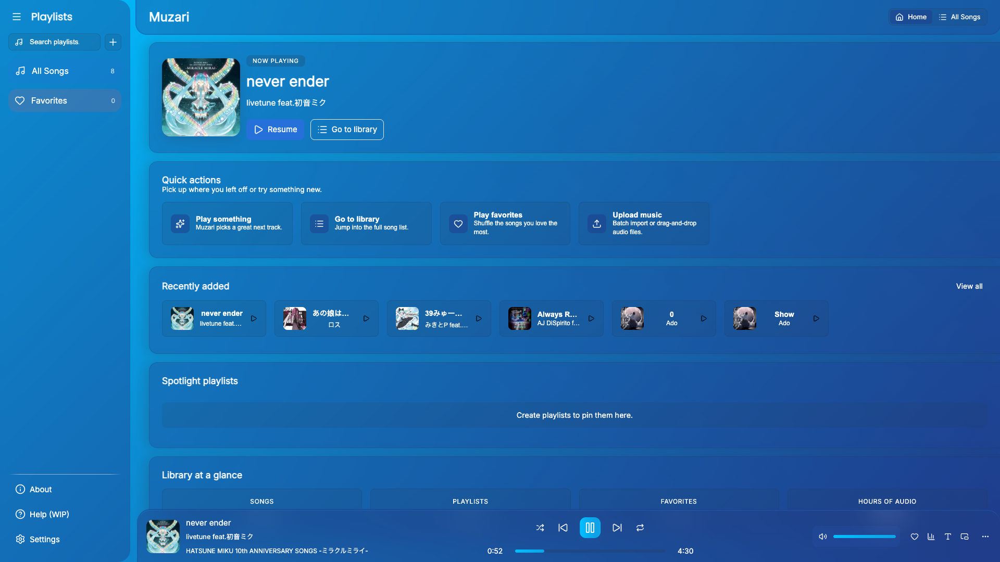
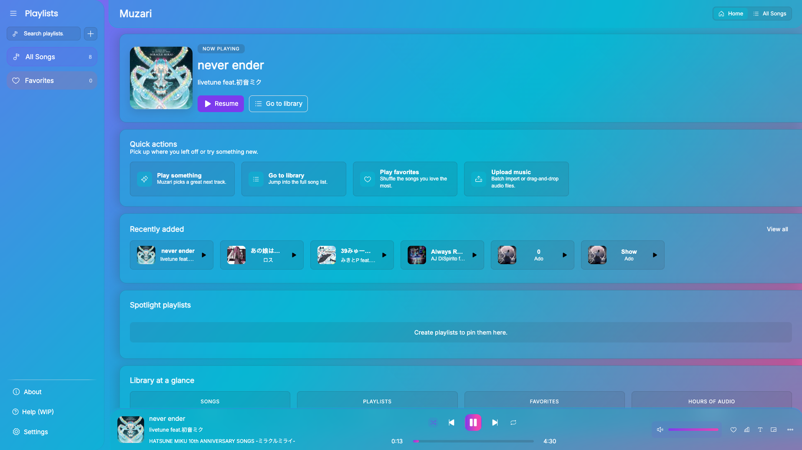
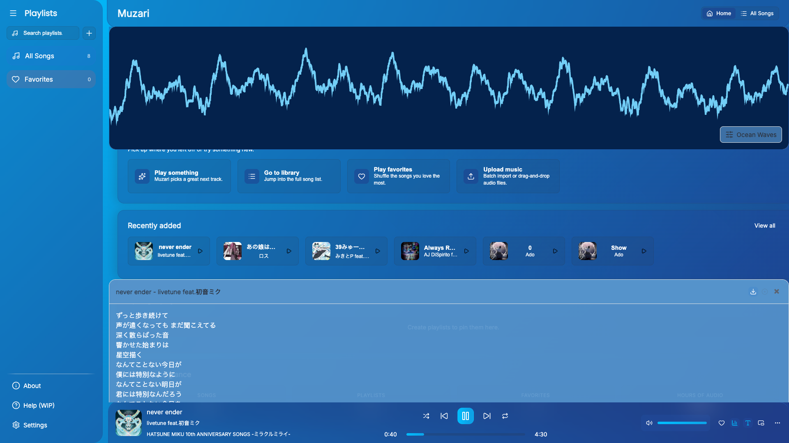
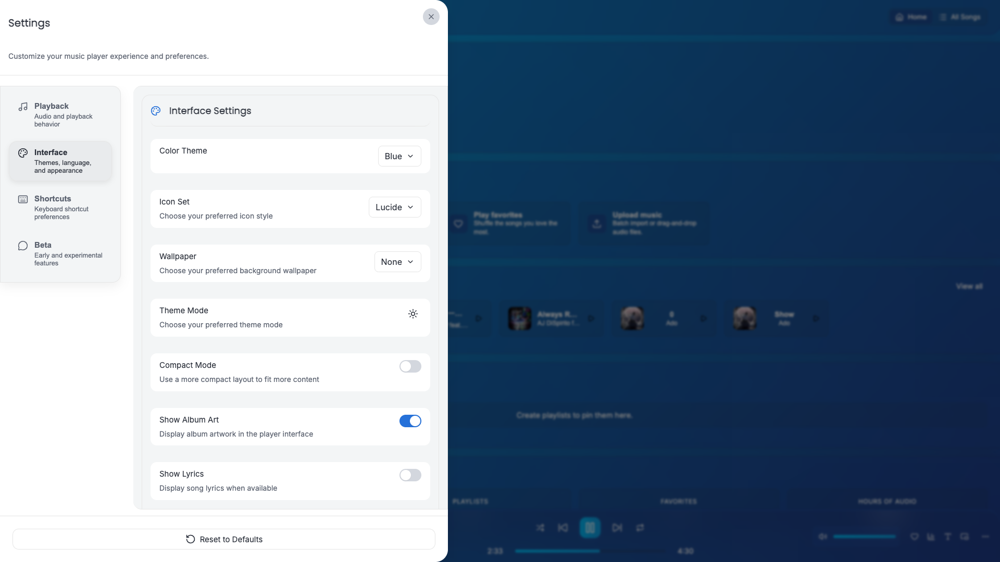
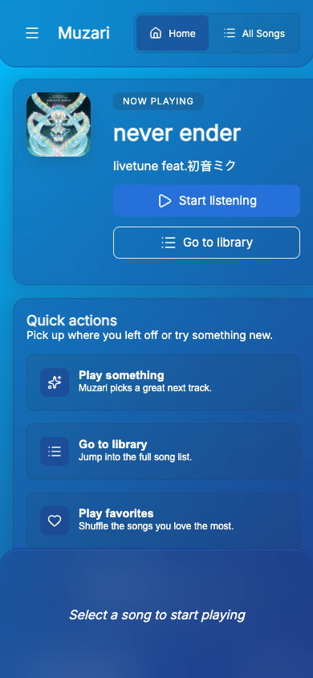
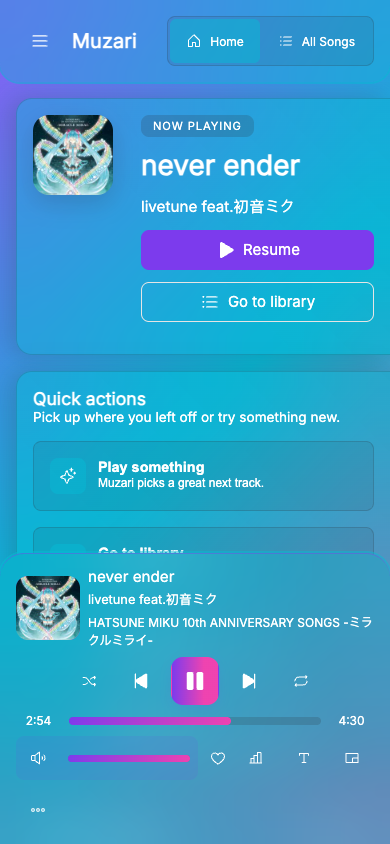
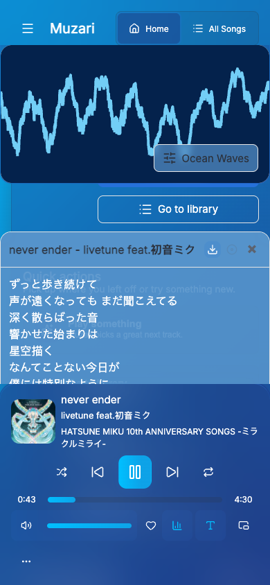
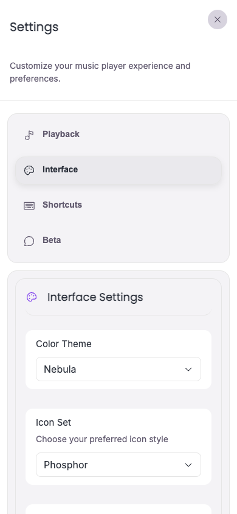

# Muzari

Modern local-first audio player for the browser and for desktop (via Tauri).

[](#contributors)


[](https://app.netlify.com/projects/muzari/deploys)


<!-- markdownlint-disable MD033 -->
<a href="https://audiflo.github.io/Muzari">
  <picture>
    <source srcset="https://chromeos.dev/badges/en/dark.svg" media="(prefers-color-scheme: dark)">
    
  </picture>
</a>

| Desktop | Custom Theme | Lyrics and Visualizer | Settings |
| --- | --- | --- | --- |
|  |  |  |  |

| Mobile | Custom Theme | Lyrics and Visualizer | Settings |
| --- | --- | --- | --- |
|  |  |  |  |

## Features

* **Local-first**: import your own audio and keep the whole library on your device. No account, no upload.
* Reads tags, cover art, and lyrics on import, with metadata from MusicBrainz and Discogs.
* Pluggable audio backends, including a Symphonia WASM decoder for formats the browser cannot play natively.
* Gapless playback and equal-power crossfade, plus a 10-band equalizer, ReplayGain, and tempo/pitch control.
* Playlists, folders, drag-and-drop, smart shuffle, and M3U import/export.
* 64 visualizers, 8 wallpapers, 29 color palettes, and 8 icon packs.
* Rebindable keyboard shortcuts and English/French localization.
* Runs as an installable PWA, a Tauri desktop app, or a **single** self-contained HTML file.

## Quick Start

Muzari is deployed to two places:
  - Netlify: https://muzari.netlify.app/
  - GitHub Pages: https://audiflo.github.io/Muzari

To build manually:

```bash
git clone https://github.com/Audiflo/Muzari.git
cd Muzari/Build
npm install
npm run build:wasm   # build the Symphonia decoder (once)
npm run dev:web      # or: npm run dev:desktop
```

Production builds:

```bash
npm run build:web      # web/PWA into dist/
npm run build:desktop  # native Tauri bundle
npm run build:single   # one self-contained HTML file
```

Requires Node.js 20+ and, for the WASM decoder, Rust with `wasm-pack`. See [Docs/BUILD.md](Docs/BUILD.md) for prerequisites and the full platform matrix.

## Contributing

Contributions are welcome. Fork the repo, make your changes under `Build/`, then run `npm run lint` and `npm test` before opening a PR against `main`.

> Starring the repository would be amazing, especially if you use the player!

## Contributors

<!-- ALL-CONTRIBUTORS-LIST:START - Do not remove or modify this section -->
<!-- prettier-ignore-start -->
<!-- markdownlint-disable -->
<table>
  <tbody>
    <tr>
      <td align="center" valign="top" width="14.28%"><a href="https://github.com/TrickiyALT"><br /><sub><b>Trickiy</b></sub></a><br /><a href="#ideas-TrickiyALT" title="Ideas, Planning, & Feedback">🤔</a> <a href="#bug-TrickiyALT" title="Bug reports">🐛</a> <a href="#design-TrickiyALT" title="Design">🎨</a></td>
    </tr>
  </tbody>
</table>

<!-- markdownlint-restore -->
<!-- prettier-ignore-end -->

<!-- ALL-CONTRIBUTORS-LIST:END -->

## License

MIT. See [LICENSE](LICENSE) for the full text.

Chromebook, ChromeOS, and the ChromeOS logo are trademarks of Google LLC.
